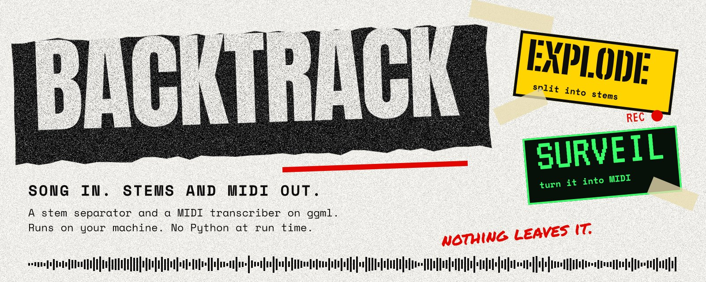
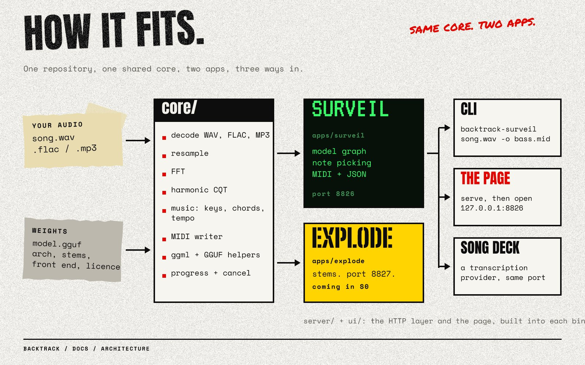

# BackTrack



A stem separator and a MIDI transcriber, built from one repository on a shared core:

- **BackTrack Explode** splits a song into stems (`backtrack-explode`, port 8827). *Coming in
  milestone S0.*
- **BackTrack Surveil** turns audio into MIDI (`backtrack-surveil`, port 8826).

Each works on its own (command line, or the page the binary serves) and as a provider inside
[Song Deck](https://github.com/jxburros/Song-Deck), through Song Deck's separation and
transcription bridge contracts. Everything runs locally on [ggml](https://github.com/ggml-org/ggml),
with weights in GGUF; no Python at run time.

> **Status: 0.0.1, milestone M2.** The repository, shared core, HTTP server and page are in
> place, and Surveil runs end to end, but with a **placeholder model** (hand-set weights, no
> training). Trained models start with T1 and T2. See [the plan](docs/plans/overall.md).

## Quick start

```bash
npm ci                                        # fetch the pinned ggml
cmake -B build -DCMAKE_BUILD_TYPE=Release && cmake --build build -j

./build/backtrack-surveil song.wav --stem bass -o bass.mid
./build/backtrack-surveil serve               # then open http://127.0.0.1:8826
```

## What it looks like

`backtrack-surveil serve` puts this page on `http://127.0.0.1:8826`: drop a track, tap the line,
read the case file, export the MIDI. Bright notes are the ones the model is sure of.


The page has its own guide: [docs/page.md](docs/page.md).

## Surveil on the command line

```bash
backtrack-surveil INPUT [--stem mix|vocals|bass|drums|piano|guitar|melody|other]
                        [--key "A minor"] [--tempo 120] [--chords chords.json] [--program 33]
                        [--pitch-bends] [-o out.mid] [--json out.json|-]
                        [--model ID|FILE.gguf] [--device NAME] [--threads N]
backtrack-surveil serve [--host 127.0.0.1] [--port 8826] [--api-key KEY] [--allow-origin URL]
backtrack-surveil models | devices | make-placeholder -o FILE.gguf
```

Input is WAV, FLAC or MP3. Output is a Standard MIDI File and, with `--json`, the same JSON the
server returns. Song context (key, tempo, chords) shapes note picking: out-of-key and
non-chord pitches are less likely, and note starts are pulled toward the tempo's grid. Bass,
vocals and melody are transcribed one note at a time.

## Surveil in Song Deck

Start `backtrack-surveil serve` and add a transcription provider at `http://127.0.0.1:8826`.
It implements Song Deck's `POST /transcribe` contract plus an optional `context` field, with
`GET /info`, `GET /health` and `POST /cancel`; see [docs/http-api.md](docs/http-api.md).

## How it works




Audio is resampled to 22.05 kHz mono and turned into a harmonic constant-Q spectrogram
([docs/front-end.md](docs/front-end.md)). A small convolutional network on ggml gives, per
frame, the likelihood of a note starting, sounding and ending at each of 88 pitches, plus a
pitch curve for bends (or hits per class, for drums). Note picking turns likelihoods into
notes in code, so behaviour changes without retraining. Models are GGUF files that carry their
own front-end settings and licence record ([docs/gguf-metadata.md](docs/gguf-metadata.md)).

## Documentation

- [The page](docs/page.md): the Surveil screen, light mode, keyboard, the design rules
- [Building](docs/building.md): ggml vendoring, GPU backends, layout
- [HTTP API](docs/http-api.md): endpoints, and one job from start to finish
- [Front end](docs/front-end.md): how Surveil hears (harmonic CQT), and
  [GGUF metadata](docs/gguf-metadata.md): what a model file says about itself
- [Design language](design/README.md): the boards, the rules and the
  [agent spec](design/AGENT-SPEC.md)
- Plans: [overall](docs/plans/overall.md), [Surveil](docs/plans/surveil.md),
  [Explode](docs/plans/explode.md)

## Licence

MIT (see [LICENSE](LICENSE)). Third-party code in `third_party/` keeps its own licence
(cpp-httplib MIT, nlohmann/json MIT, dr_libs public domain or MIT-0); ggml is MIT.
