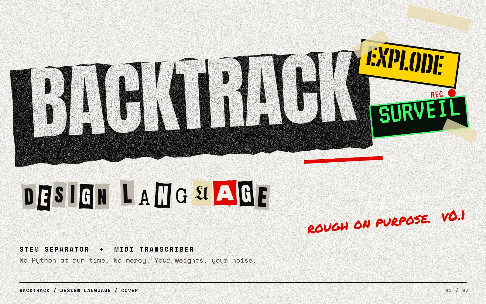

# BackTrack design language

Rough on purpose. BackTrack looks like a photocopied gig flyer that happens to run a neural network.
These boards show a first pass: one shared base and four themes. They are proposals to react to,
not a finished spec.

| Board | What it shows |
| --- | --- |
| [01 Cover](boards/01-cover.jpg) | Wordmark, app stickers, tone |
| [02 Rules](boards/02-rules.jpg) | The six rules every screen follows |
| [03 Parts](boards/03-parts.jpg) | Palette, type, buttons, stamps, scraps, waveforms |
| [04 Xerox Riot](boards/04-theme-xerox-riot.jpg) | Hub and light mode (default) |
| [05 Blast Zone](boards/05-theme-blast-zone.jpg) | **Backtrack Explode**, the stem separator |
| [06 Wiretap](boards/06-theme-wiretap.jpg) | **Backtrack Surveil**, the MIDI transcriber |
| [07 Gig Flyer](boards/07-theme-gig-flyer.jpg) | Release pages, socials, changelogs |

All seven are also in [backtrack-design-language.pdf](backtrack-design-language.pdf).

**Building UI?** Agents and developers should start with [AGENT-SPEC.md](AGENT-SPEC.md). It has the
rules, components, copy and acceptance checks, backed by [tokens.json](tokens.json),
[backtrack.css](backtrack.css), [waveform.js](waveform.js) and the reference screens in
[preview.html](preview.html).

## The rules

1. **Loud before pretty.** One shout per screen: a huge condensed headline, then quiet.
2. **Nothing sits straight.** Tilt scraps, tape and headlines 1-4°. Never tilt a button, an input or
   a number someone has to read.
3. **Photocopy it.** Grain and toner on surfaces and display type. Body text stays clean.
4. **One hot colour.** Each app owns one: Explode is hazard yellow, Surveil is phosphor green, the hub
   is riot red.
5. **Tape, don't box.** Torn paper, tape and stamps instead of cards, soft shadows and gradients.
6. **Say it plain.** Verbs over vibes: RIP, DROP, TAP, BLOW IT UP. Never "unlock your creativity".

The short version: break the look, never the tool. Controls, numbers and status stay square, legible
and in the same place.

## Palette

| Name | Hex | Use |
| --- | --- | --- |
| Bone | `#F1EFE9` | Light background, paper |
| Ink | `#0D0D0D` | Text, primary buttons, slabs |
| Xerox | `#BDB8AD` | Secondary surfaces, drop zones |
| Tape | `#E8DCB0` | Tape strips (78% opacity), file scraps |
| Riot red | `#E10600` | Hub accent, REC, errors, margin scrawl |
| Hazard | `#FFD400` | Explode accent |
| Flash | `#FF6A00` | Explode: vocals stem and the main action |
| Phosphor | `#39FF6A` | Surveil accent |
| CRT | `#07110A` | Surveil background |
| Gig pink | `#FF2E93` | Gig Flyer only |
| Acid | `#D6FF2E` | Gig Flyer only |

## Type

All Google Fonts, all open licences.

| Role | Face | Use |
| --- | --- | --- |
| Shout | Anton | One headline per screen |
| Work | Space Mono (400, 700) | UI, labels, numbers, body |
| Scrawl | Permanent Marker | Margin notes. Never instructions, never controls |
| Explode display | Big Shoulders Stencil Display 900 | Explode titles and stem names, 40 px and up |
| Surveil display | VT323 | Surveil titles and readouts |
| Flyer | UnifrakturMaguntia, Rubik Mono One, Special Elite | Ransom-note lettering, Gig Flyer only |

## Themes

**Xerox Riot (hub, light mode).** Bone paper, black toner, one red. The hub's drop zone is a torn
xerox scrap with a dashed edge; the two apps are flat tiles in their own colours. Use it for the
hub, settings and run history, and as the light mode for both apps.

**Blast Zone (Explode).** Demolition site: near-black, hazard tape across the top, stencil type.
Stems are rows with bar waveforms in hazard yellow (vocals in flash orange), mute and solo squares
on the right. Progress is a hazard bar with chunk and pass counts under it. The main action is
DETONATE.

**Wiretap (Surveil).** A CCTV monitor and a case file. Phosphor green on CRT black with faint
scanlines, a REC dot and a running timestamp. The piano roll shows confidence as brightness (bright
= sure, dim = guessing). A redaction bar marks a value that is unknown or hidden. Red is only for
REC and errors.

**Gig Flyer (releases).** The loudest mode, kept out of the apps. A fluoro poster with blackletter
brand, ransom-note lettering and tear-off tabs, for release notes, socials and changelogs.

## Editing the boards

The boards are made with [Vixl](https://github.com/jxburros/Vixl). Every layer stays editable:

- `source/vixl/*.vixl` are the layered documents. Open them with `vixl open`, or edit them in the
  Vixl MCP server.
- `source/docs_art.py` draws the pictures in `docs/images/` (banners, diagrams, the page tour)
  from the same kit; `source/docs_shots.py` takes the page screenshots it uses. See
  [docs/page.md](../docs/page.md#the-pictures-in-these-docs).
- `source/boards.py` rebuilds all seven boards, the JPEGs and the PDF; `source/kit.py` has the shared
  pieces (torn paper, tape, ransom lettering, waveforms). Run `python design/source/boards.py`
  with Vixl installed. Fonts download from Google Fonts on the first run.
