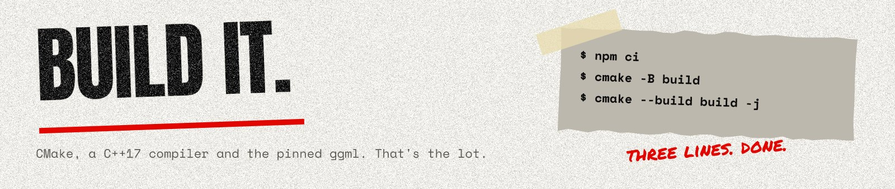

# Building



Needs CMake 3.16+, a C++17 compiler, Git, and Node.js/npm (only to fetch ggml). Python 3 runs
the smoke test.

```bash
npm ci                      # fetches and verifies the pinned ggml (scripts/install-vendor.js)
cmake -B build -DCMAKE_BUILD_TYPE=Release
cmake --build build -j
ctest --test-dir build      # unit tests
python3 scripts/smoke-test.py   # CLI and HTTP server, end to end
```

## ggml

Both apps run on standalone [ggml](https://github.com/ggml-org/ggml), pinned in
`packaging/vendor/ggml.conf` to `36da571`: the revision Onyx Engine's llama.cpp pin last
synced, so a ggml fix or a new GPU backend reaches Onyx Engine and BackTrack together. The
vendoring scripts are Onyx Engine's, copied unchanged (`packaging/make-vendor-package.sh`,
`packaging/vendor/lib.sh`, `scripts/vendor.sh`, `scripts/install-vendor.js`); only the spec file
is ours. See Onyx Engine's `docs/building.md` for how specs work.

CMake looks for the source in this order:

1. `-DBACKTRACK_GGML_DIR=<path>`
2. `node_modules/@jxburros/ggml-source` (what `npm ci` installs; its commit stamp must match the pin)
3. `vendor/ggml` (a tree you placed by hand, for offline work)

`npm run vendor` (or `npm run vendor -- /path/to/ggml-checkout`) stages a pruned tarball and
installs it instead.

When Onyx Engine moves its llama.cpp pin, move this one with it: from an Onyx Engine checkout,
`scripts/check-ggml-pin.sh ../BackTrack/packaging/vendor/ggml.conf` prints the commit to use.

## GPU backends

Same switches as Onyx Engine, forwarded to ggml:

```bash
cmake -B build -DBACKTRACK_VULKAN=ON     # or BACKTRACK_CUDA, BACKTRACK_METAL, BACKTRACK_HIP, BACKTRACK_BLAS
```

`backtrack-surveil devices` lists what a build can use; `--device NAME` picks one (the default
is the best available).

For a portable CPU build (CI, releases) add `-DGGML_NATIVE=OFF`.

## WebAssembly

Surveil also builds with Emscripten, for Song Deck's page; see [wasm/README.md](../wasm/README.md):

```bash
bash scripts/install-emsdk.sh ~/emsdk && source ~/emsdk/emsdk_env.sh
emcmake cmake -B build-wasm -DCMAKE_BUILD_TYPE=Release && cmake --build build-wasm -j
```

## Layout


```
core/            audio decode (WAV/FLAC/MP3 via dr_libs), resampling, FFT, harmonic CQT,
                 music theory, MIDI writer, ggml/GGUF helpers, progress and cancellation
server/          shared HTTP layer (bridge rules, /health /cancel, auth, CORS, job queue)
ui/              the page both binaries serve, with its CSS, scripts and fonts (embedded at configure
                 time by cmake/EmbedPage.cmake; the look is design/AGENT-SPEC.md)
apps/surveil     transcriber: model graph, placeholder models, note picking, CLI and server
apps/explode     separator (S0)
wasm/            the WebAssembly build of Surveil and its JS wrapper (T4)
training/        training code (T1)
third_party/     cpp-httplib, nlohmann/json, dr_libs
tests/           unit tests
scripts/         vendoring, test audio, smoke test
design/          the design language: boards, tokens, the reference CSS, and the scripts that
                 draw the boards and these docs' pictures (design/source/, with Vixl)
```
