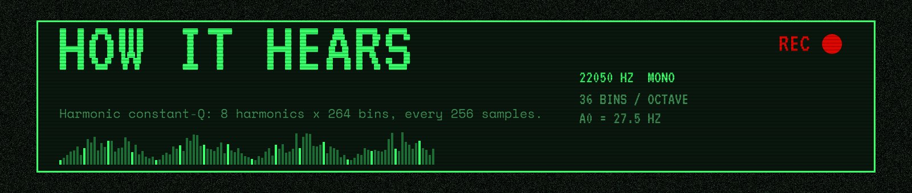
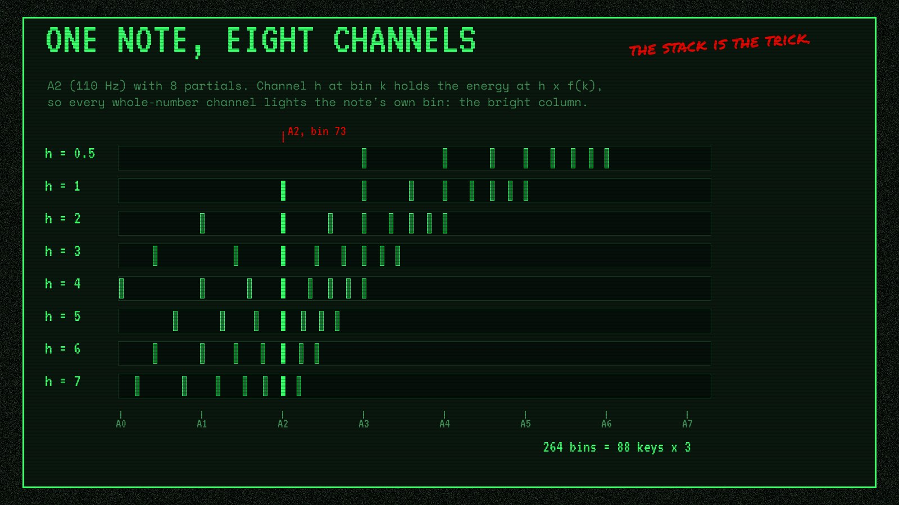

# The transcriber's front end: harmonic CQT

`core/src/hcqt.cpp`. The training code must compute exactly this; the T1 parity check compares
the two on fixed clips. Settings come from the model's GGUF metadata
([gguf-metadata.md](./gguf-metadata.md)); defaults in brackets.

## Input

Decoded audio is averaged to mono and resampled to `sample_rate` [22050] with a
Kaiser-windowed sinc (β 9, 32 zero crossings at the lower rate, `core/src/audio.cpp`).

## Bins

`B = 12 × bins_per_semitone` [36] bins per octave. Bin `k` has frequency

    f(k) = fmin × 2^((k − c) / B),   c = floor(bins_per_semitone / 2)  [1]

so the centre bin of pitch `p` is `k = 3 (p − 21) + 1` and bin 1 is exactly `fmin` [27.5 Hz,
A0]. The model sees `n_bins` [264] bins.

Harmonic channel `h` (from `harmonics`, [0.5, 1, 2, 3, 4, 5, 6, 7]) reads bin
`k + round(B × log2 h)` of one extended transform, so channel h at bin k is the energy at
`h × f(k)`. Extended bins above `top_fraction × sample_rate / 2` [0.9 × Nyquist] are not
computed and read as 0.

Why stack harmonics: a pitched note puts energy at f, 2f, 3f and up. Channel h at the note's own
bin reads the energy at h × f, so every whole-number channel lights the same bin, and the model
sees a pitch as one bright column through the stack instead of a pattern spread across the
spectrum. The picture is computed from the layout above for A2 (110 Hz) with eight partials:

## Kernels

`Q = filter_scale / (2^(1/B) − 1)` [51.4]. Each extended bin is assigned an octave group
`o = floor(log2(f_cap / f))`, `f_cap = top_fraction × sample_rate / 2`, and runs at rate
`r = sample_rate / 2^o`. Its kernel:

- length `N = ceil(Q r / f)`, forced odd (`N |= 1`), at most `L − 1`;
- for `m = −(N−1)/2 … (N−1)/2`: `w(m) = ½ (1 + cos(2π m / (N + 1)))`,
  `g(m) = w(m) e^{2πi f m / r} / Σw`.

`L` = the next power of two ≥ `ceil(2Q / top_fraction) + 2` [256], shared by all groups. The
kernel is placed at `L/2 + m` in an `L`-point buffer and transformed; spectral coefficients below
`1e-3 ×` the largest are dropped (the sparse kernel).

## Octaves

Group 0 uses the resampled signal; each next group halves the rate with a zero-phase 101-tap
low-pass (Kaiser β 8 windowed sinc, cutoff a quarter of the input rate, normalised to unity DC
gain): `y[i] = Σ_j h[j] x[2i + 50 − j]`, samples outside the signal taken as 0.

## Frames

`n_frames = floor(n_samples / hop) + 1`; frame `t` is centred on sample `t × hop` [256] of the
group-0 signal, i.e. sample `round(t × hop / 2^o)` of group `o`. For each frame and group: take
the `L` samples starting at `centre − L/2` (zero outside the signal), FFT, and for each bin sum
`X[j] × conj(G[j]) / L` over its sparse coefficients. That equals `Σ_n x[n] conj(g[n])` over the
kernel, so a sine of amplitude A gives magnitude A/2.

## Scale

`v = clamp(1 + 20 log10(max(|X|, 1e-5)) / 80, 0, 1)`: a full-scale sine reads 0.92, −80 dB and
below 0. The scale is fixed, not per clip, so chunks and whole files agree.

## Layout

`data[(h × n_frames + t) × n_bins + k]`, which is the ggml input tensor
`[n_bins, n_frames, n_harmonics]`.
