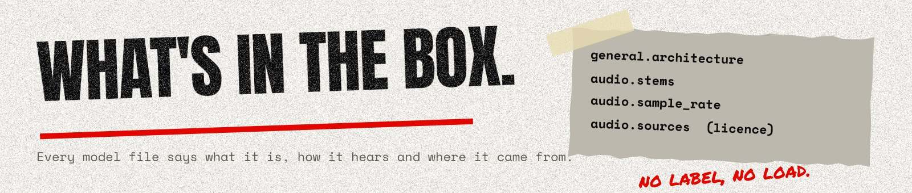

# GGUF metadata for BackTrack audio models

BackTrack owns this contract (overall plan, "Contracts between the projects"); the apps, JX
Runtime and Song Deck's `"model"` plugin kind read it. New keys stay optional.

Weights are GGUF files: tensors in F32, metadata as below. Every model carries its own
front-end settings, so a model trained with different settings runs correctly without code
changes.

## Keys every audio model has

| Key                    | Type          | Meaning                                                                        |
| ---------------------- | ------------- | ------------------------------------------------------------------------------ |
| `general.architecture` | string        | Graph the binary builds: `surveil-cnn` (transcription). Explode adds its own. |
| `general.name`         | string        | Display name                                                                   |
| `general.version`      | string        | Model version                                                                  |
| `general.license`      | string        | Licence of the weights                                                         |
| `audio.task`           | string        | `transcribe` or `separate`                                                     |
| `audio.arch`           | string        | Same as `general.architecture`                                                 |
| `audio.stems`          | string array  | Song Deck sources (transcription) or stems produced (separation)               |
| `audio.sample_rate`    | uint32        | Rate the model runs at                                                         |
| `audio.sources`        | string array  | Licence record: every dataset or render set that went into training            |
| `audio.placeholder`    | bool          | Untrained placeholder (optional, default false)                                |

## Transcription (`surveil-cnn`)

| Key                        | Type         | Default                    | Meaning                                                   |
| -------------------------- | ------------ | -------------------------- | --------------------------------------------------------- |
| `audio.kind`               | string       | `pitched`                  | `pitched` (notes) or `drums` (hits per class)             |
| `audio.hop`                | uint32       | 256                        | Samples per frame                                         |
| `audio.fmin`               | float32      | 27.5                       | Centre frequency of the lowest pitch                      |
| `audio.bins_per_semitone`  | uint32       | 3                          | Front-end resolution                                      |
| `audio.n_bins`             | uint32       | 264                        | Front-end bins (88 pitches × 3)                           |
| `audio.harmonics`          | float32 array| 0.5, 1, 2, 3, 4, 5, 6, 7   | Harmonic channels                                         |
| `audio.top_fraction`       | float32      | 0.9                        | Bins above this fraction of Nyquist are zero              |
| `audio.filter_scale`       | float32      | 1                          | Kernel length multiplier (drums use less, for timing)     |
| `audio.pitch_min`          | uint32       | 21                         | Pitched: MIDI note of output 0                            |
| `audio.classes`            | string array | —                          | Drums: class names, e.g. `kick`, `snare`, `toms`, ...     |
| `audio.class_notes`        | int32 array  | —                          | Drums: General MIDI note per class                        |
| `audio.placeholder_init`   | string       | —                          | Placeholders: `wired` or `random`                         |
| `audio.training`           | string       | —                          | Optional: how it was trained, as JSON (epochs, data size, layout, valid score); informational |

The front end these keys describe is in [front-end.md](./front-end.md).

### Tensors

Kernel shapes are ggml order, `[KW (frequency), KH (time), C_in, C_out]`; kernel sizes must be
odd (except the pool), and the graph pads to keep the frame count. `C` below is the last trunk
layer's channel count.

| Tensor                               | Shape                       | Kind    |
| ------------------------------------ | --------------------------- | ------- |
| `conv1.weight`, `conv1.bias`         | `[kw, kh, harmonics, C1]`, `[C1]` | both |
| `conv2.weight`, `conv2.bias`         | `[kw, kh, C1, C2]`, `[C2]`  | both    |
| `conv3.weight`, ... (optional)       | `[kw, kh, C2, C3]`, ... each reading the previous layer | both |
| `contour.weight`, `contour.bias`     | `[kw, kh, C, 1]`, `[1]`     | pitched |
| `pool.weight`, `pool.bias`           | `[bins_per_semitone, 1, C, P]`, `[P]` (stride `bins_per_semitone` in frequency) | pitched |
| `note.weight`, `note.bias`           | `[1, kh, P, 1]`, `[1]`      | pitched |
| `onset.weight`, `onset.bias`         | `[1, kh, P, 1]`, `[1]`      | pitched |
| `offset.weight`, `offset.bias`       | `[1, kh, P, 1]`, `[1]`      | pitched |
| `band.weight`, `band.bias`           | `[n_bins × C, D]`, `[D]`    | drums   |
| `tconv1.weight`, ... (optional)      | `[1, kh, D, E1]`, `[E1]`, then `[1, kh, E1, E2]`, ... | drums |
| `onset.weight`, `onset.bias`         | `[1, kh, 1, 1]`, `[classes]` (shared), or `[1, kh, E, classes]`, `[classes]` | drums |

The drum head has two forms. **Shared** (T0, the `wired` placeholder): `D = classes`, no
`tconv`, and one `[1, kh, 1, 1]` onset kernel slides along time for every class, with a bias per
class. **Temporal** (T2): `band` maps to `D` channels, optional `tconv1, tconv2, ...` are
convolutions in time over those channels, and `onset` is a full kernel from the last layer's
`E` channels (`D` with no `tconv`) to the classes. The trained drum model uses trunk
`3×3 → 16`, `3×3 → 8`, `D = 32`, two 9-frame `tconv` of 32 and a 5-frame onset kernel: about
90k parameters (`training/model.py`, `DRUM_LAYOUT`).

Activations: ReLU after every trunk layer, `pool`, `band` and every `tconv`; sigmoid on every
head. Rows of `band.weight` index the trunk as `channel × n_bins + bin`.

The **receptive radius** is the sum of `KH / 2` over the time kernels on the way to an output
(trunk, then `tconv` and `onset` for drums, or the larger of `contour` and the heads for
pitched): 3 frames for the placeholders, 12 for the trained drum layout. The binary runs the
graph in chunks of 512 frames with that many frames of context each side (zeros beyond the
clip), so results do not depend on the chunking. Layers are optional only as listed: a tensor
the graph does not read (`conv4` without `conv3`, say) is rejected as a newer layout.

ggml's 2-D convolution rounds its input and kernel to float16 (accumulating in float32); the
`band` layer is a float32 product. The training code mirrors that for the parity check
(`training/model.py`, `ggml_parity`).

`backtrack-surveil make-placeholder -o model.gguf [--kind drums] [--init random --seed N]
[--head temporal]` writes a file in this format; `python3 -m training.export` reads such files
into PyTorch and the training code writes the same ([training/README.md](../training/README.md)).
