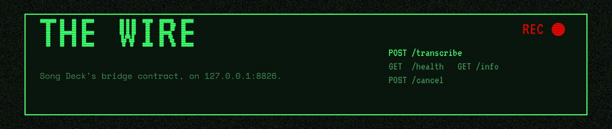
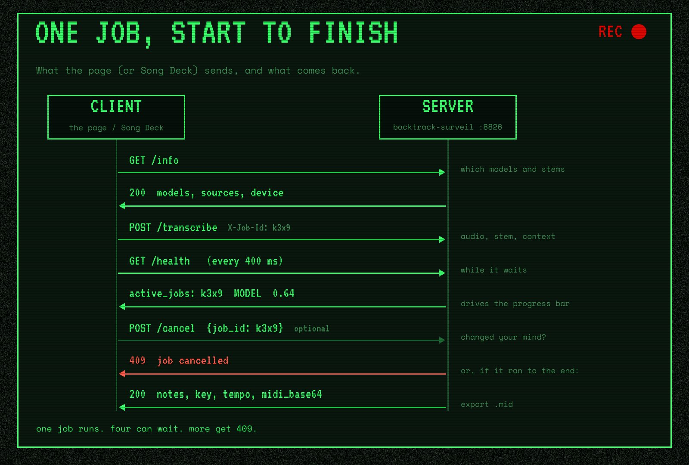
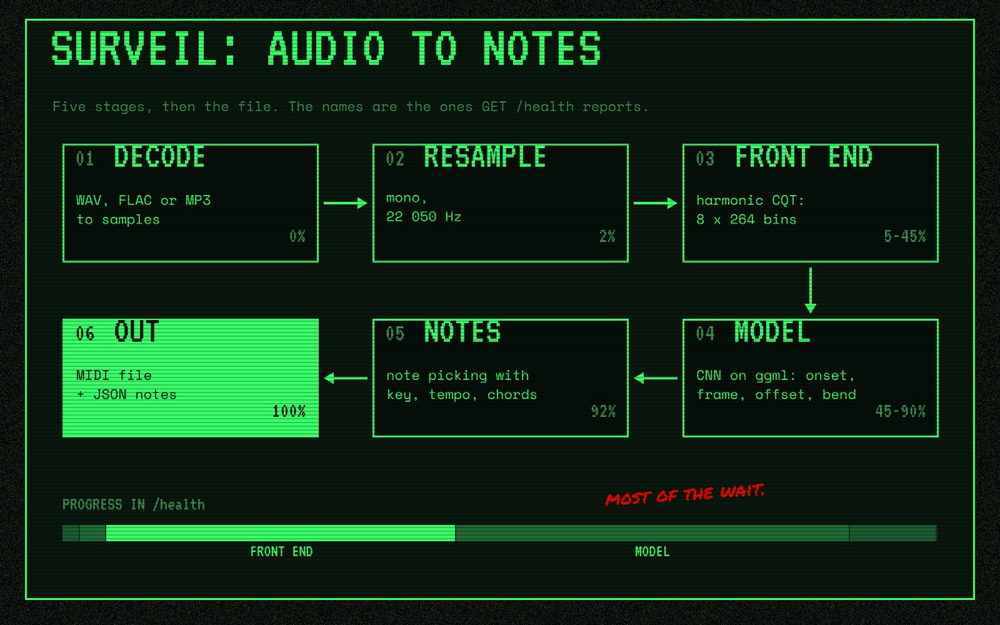

# HTTP API



Both apps serve Song Deck's bridge contracts (`packages/ai/src/contracts.ts` in Song Deck; Song
Deck owns them) through the shared layer in `server/`, which follows the same rules as Song
Deck's own Python bridges (`bridges/songdeck_bridge/server.py`). This page covers BackTrack
Surveil, then [BackTrack Explode](#backtrack-explode) (`POST /separate`, port 8827).

```
backtrack-surveil serve              # http://127.0.0.1:8826, page at /
```

## One job, start to finish

This is what the page does, and what Song Deck's adapter does without the polling.



## Rules common to both apps

| Rule              | Behaviour                                                                                                                                                                                         |
| ----------------- | ------------------------------------------------------------------------------------------------------------------------------------------------------------------------------------------------- |
| Bind address      | `127.0.0.1` unless `--host` says otherwise. Bound to loopback, requests whose `Host` is not a loopback name get 403 (DNS-rebinding protection); `--allow-host NAME` adds names.                      |
| Auth              | Off by default. `--api-key KEY` (or `$BACKTRACK_API_KEY`) requires `Authorization: Bearer KEY` on everything except `GET /health` and the page (`GET /` and its files: CSS, scripts, fonts). Compared in constant time. 401 otherwise. |
| CORS              | Allowed origins are Song Deck's studio and local server (`http://localhost:5173`, `http://127.0.0.1:5173`, `http://localhost:7788`, `http://127.0.0.1:7788`) plus the page's own origin. `--allow-origin URL` (repeatable) replaces the list; `*` allows any. Other origins get 403. Preflights (including Private Network Access) answer 204. |
| Errors            | Non-2xx with `{"error": "<message>"}`: 400 invalid input, 401 auth, 403 origin or host, 404 unknown model or endpoint, 409 busy or cancelled, 413 body too large, 503 shutting down or loading.     |
| Jobs              | One job runs at a time; up to `--max-queue` (default 4) wait behind it, and more get 409. A job stops when its client disconnects or on `POST /cancel`. `X-Job-Id` (request or generated) comes back on the response. |
| Body size         | 512 MB by default (`--max-body-mb`).                                                                                                                                                               |

## `POST /transcribe`

Song Deck's `TranscriptionBridgeRequest`, plus the optional `context` the plan adds, plus
`include_midi` for the page.

```jsonc
{
  "audio_base64": "<WAV, FLAC or MP3 bytes, base64>",
  "source": "bass",            // mix | vocals | bass | drums | piano | guitar | melody | other (default mix)
  "pitch_bends": true,         // optional: notes[].bend
  "model": "placeholder",      // optional: a model id from /info, or a stem name ("drums")
  "context": {                 // optional, every field optional
    "key": "E minor",          // lowers out-of-key pitches; echoed as "key"
    "tempo": 100,              // BPM; pulls note starts to the 16th-note grid; echoed as "tempo"
    "chords": [{ "symbol": "Em", "start": 0, "end": 2.4 }],  // lowers non-chord tones in each span
    "program": 34,             // General MIDI program reported on each note
    "pitch_range": [28, 67],   // lowest and highest MIDI note of the part (else the stem's range)
    "monophonic": true         // one note at a time (else bass, vocals and melody are)
  },
  "include_midi": false        // optional: also return "midi_base64" (a Standard MIDI File)
}
```

The contract says WAV; the server sniffs the bytes, so FLAC and MP3 work too.

Response, Song Deck's `TranscriptionBridgeResponse` plus `model`:

```jsonc
{
  "notes": [
    {
      "pitch": 40, "start": 0.0116, "end": 0.6734,   // MIDI note, seconds
      "velocity": 113,                              // 1..127
      "confidence": 0.892,                          // the model's mean likelihood over the note, 0..1
      "bend": [[0.0, -4.3], [0.5, 2.1]],            // with pitch_bends: [position 0..1, cents]
      "program": 33                                 // context.program, or the stem's default
    }
  ],
  "tempo": 100,          // context.tempo, else estimated from the onsets (omitted below six notes)
  "key": "E minor",      // context.key, else estimated (pitched models only)
  "model": "placeholder"
}
```

Drum notes use General MIDI drum numbers (kick 36, snare 38, toms 45, closed hi-hat 42, open
hi-hat 46, crash 49, ride 51), last 0.1 s and carry no `program`.

Which model runs: `model` if given (an id, or a stem name, which picks the model for that
stem), else the first model whose `audio.stems` includes `source`, trained models before
placeholders.

**Contract note.** `context` is optional and every field in it is optional. Song Deck adopted it
in `TranscriptionBridgeRequest` as:

```ts
context?: {
  key?: string;
  tempo?: number;
  chords?: { symbol: string; start: number; end: number }[];
  program?: number;
  pitch_range?: [number, number];
  monophonic?: boolean;
};
```

## `GET /info`

```jsonc
{
  "name": "BackTrack Surveil", "app": "surveil", "version": "0.0.1", "role": "transcription",
  "models": [
    { "id": "placeholder", "name": "Surveil placeholder (pitched)", "kind": "pitched",
      "stems": ["mix", "vocals", "bass", "piano", "guitar", "melody", "other"],
      "placeholder": true, "license": "MIT", "version": "0.0.1" },
    { "id": "placeholder-drums", "kind": "drums", "stems": ["drums"], "...": "..." }
  ],
  "sources": ["mix", "vocals", "bass", "drums", "piano", "guitar", "melody", "other"],
  "device": "CPU",
  "pitch_bends": true,
  "context": ["key", "tempo", "chords", "program", "pitch_range", "monophonic"],
  "capabilities": ["AUDIO_TRANSCRIPTION", "AUDIO_TO_MIDI"]
}
```

## `GET /health`

No auth. The page polls it for progress. While Surveil works, `stage` moves through `decode`,
`resample`, `front end`, `model` and `notes`; `progress` is the fraction done, and most of the
wait is the front end and the model:



```jsonc
{
  "status": "ok",                 // ok | loading | shutting-down
  "name": "BackTrack Surveil", "app": "surveil", "version": "0.0.1", "role": "transcription",
  "uptime_seconds": 12.3, "auth_required": false,
  "jobs": { "running": 1, "queued": 0, "max_jobs": 1, "max_queue": 4,
            "completed": 3, "failed": 0, "cancelled": 1, "rejected": 2 },
  "active_jobs": [ { "id": "a1b2c3", "path": "/transcribe", "state": "running",
                     "stage": "model", "progress": 0.62, "seconds": 1.4 } ]
}
```

## `POST /cancel`

`{"job_id"?: "..."}` cancels that job, or every running and queued job. Answers 204 with
`X-Cancelled-Jobs: <n>`. The cancelled request answers 409 `job cancelled (...)`.

## Using it from Song Deck

Song Deck's transcription adapter (`packages/ai/src/adapters/transcription-http.ts`) works as
is: add a transcription provider with base URL `http://127.0.0.1:8826`. A one-click preset is
milestone T3.

## BackTrack Explode

```
backtrack-explode serve              # http://127.0.0.1:8827, page at /
```

The rules above apply unchanged (bind address, auth, CORS, errors, jobs, body size).

### `POST /separate`

Song Deck's `SeparationBridgeRequest`, plus `passes` and `format`:

```jsonc
{
  "audio_base64": "<WAV, FLAC or MP3 bytes, base64>",
  "stems": ["drums", "bass", "vocals", "other"],  // optional: default GET /info's "stems"
  "model": "placeholder",      // optional: a model id from /info
  "augment": true,             // optional: average 2 passes (plain, then flipped and swapped)
  "passes": 3,                 // optional, 1-4, overrides augment: plain, flip + swap, flip, swap
  "format": "pcm16"            // optional: pcm16 (default), pcm24 or float32
}
```

Response, Song Deck's `SeparationBridgeResponse` plus details:

```jsonc
{
  "stems": { "vocals": "<WAV base64>", "drums": "...", "bass": "...", "other": "..." },
  "model": "placeholder",
  "passes": 2,
  "placeholder": true,
  "sample_rate": 44100,        // every stem: 44.1 kHz stereo, as long as the input
  "seconds": 221.4,
  "chunks": 12
}
```

Which stems come back:

- The ones asked for, in that order. A stem the model can't make is a 400 that lists what it
  can make (Song Deck's adapter drops those before asking, from `/info`).
- `other` or `instrumental` holds everything not in the other stems asked for, so
  `["vocals", "instrumental"]` is a two-stem split. Asking for both is a 400.
- When neither is asked for, `other` is added with the rest, so the stems always sum to the mix:
  `["vocals"]` gives `vocals` and `other`.

The stems sum to the input resampled to 44.1 kHz stereo (mono is doubled; with more channels,
even ones go left and odd ones right), exactly in `float32` and to within the rounding of each
stem in `pcm16` and `pcm24`.

While a job runs, `GET /health` reports its `stage` as `decode`, `resample`, then
`chunk 3/12, pass 1/2` per chunk and pass, then `stems` and `encode`.

### `GET /info`

```jsonc
{
  "name": "BackTrack Explode", "app": "explode", "version": "0.7.0", "role": "separation",
  "models": [
    { "id": "placeholder", "name": "Explode placeholder (masks, no training)",
      "stems": ["vocals", "drums", "bass", "other"], "on_request_stems": ["instrumental"],
      "placeholder": true, "license": "MIT", "version": "0.7.0" }
  ],
  "model": "placeholder",                            // the default model
  "stems": ["vocals", "drums", "bass", "other"],     // the default model's, as Song Deck reads them
  "on_request_stems": ["instrumental"],
  "sample_rate": 44100, "device": "CPU", "augment": true, "max_passes": 4,
  "formats": ["pcm16", "pcm24", "float32"],
  "capabilities": ["SOURCE_SEPARATION", "VOCAL_ISOLATION", "STEM_OUTPUT"]
}
```

### Using it from Song Deck

Song Deck's separation adapter (`packages/ai/src/adapters/separation-http.ts`) works as is: add
a separation provider with base URL `http://127.0.0.1:8827`. It reads `stems` and
`on_request_stems` from `/info`, so asking for guitar gets the other stems with guitar left in
`other`. A one-click preset is milestone S3, with the first release.
