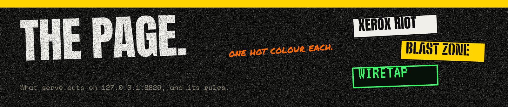
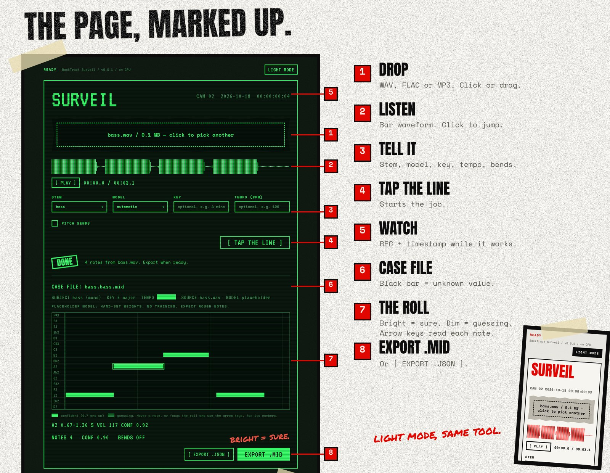

# The page



Each binary serves a page. Start the server, open the address, drop a track:

```bash
backtrack-surveil serve          # then open http://127.0.0.1:8826
backtrack-explode serve          # then open http://127.0.0.1:8827
```

It runs on your machine. Nothing leaves it: the fonts, styles and scripts are built into the
binary, and the page talks only to the server that served it.

## Surveil, step by step



1. **Drop.** Drag a WAV, FLAC or MP3 onto the drop zone, or click it (or tab to it and press
   Enter) to pick one.
2. **Listen.** The waveform of the file you picked. `[ PLAY ]` plays it; click the waveform to
   jump.
3. **Tell it.** The stem (a file named `bass.wav` picks *bass* for you), the model (automatic
   picks the one made for that stem), and, if you know them, the key and tempo. Context makes
   out-of-key notes less likely and pulls note starts onto the beat. Tick *pitch bends* to keep
   slides and vibrato.
4. **Tap the line.** `[ TAP THE LINE ]` starts the job.
5. **Watch.** REC and the CAM timestamp run while it works. The bar under the settings shows
   the real stage and percentage (`MODEL • 64% • 1.8 S`); `CANCEL` stops it.
6. **Case file.** What came back: the file it will save, the stem, the key and tempo it used or
   found, the source file and the model. A black bar means *unknown*: hover it, or a screen
   reader reads "unknown".
7. **The roll.** Bright notes are confident (0.7 and up); dim ones with an outline are guesses.
   Lines are beats (bars every four) when the tempo is known, seconds when it is not. Hover a
   note for its pitch, times, velocity and confidence, or click the roll and use the arrow keys
   (Home and End jump to the first and last note). Playback draws a line across it.
8. **Export.** `EXPORT .MID` saves a Standard MIDI File, `[ EXPORT .JSON ]` the notes as JSON
   (the same JSON the [HTTP API](http-api.md) returns).

If the model is a placeholder (hand-set weights, no training), the case file says so. Expect
rough notes until the trained models land.

## Explode, step by step

1. Drop a WAV, FLAC or MP3 on the torn drop zone, or click it to pick one.
2. Tick the stems you want. **Instrumental** (on request) and **Other** each hold whatever the
   other ticked stems don't, so tick one of them, not both. **Two passes** averages a second,
   polarity-flipped and channel-swapped pass: slower, a little steadier.
3. **DETONATE.** The bar moves per chunk and pass (`CHUNK 3/12 • PASS 1/2`); **Cancel** stops it.
4. Each stem gets a row: its name, its waveform (all on one scale, so a quiet stem looks quiet),
   **M**ute, **S**olo and **Save**. **Play** plays the stems together, with mute and solo
   applied as you change them; click a waveform to jump. **Save all stems** saves each as
   `song.<stem>.wav`.

With the placeholder model the page says so: its stems are rough, for trying the app.

## When it goes wrong

Errors say what failed and what to do. No jokes, no "oops".

| You see | What to do |
| --- | --- |
| `COULDN'T READ song.m4a. Use WAV, FLAC or MP3.` | Convert the file. The page checks the extension, the server checks the bytes. |
| `KEY REJECTED. Enter the key the server was started with.` | The server runs with `--api-key`; type it in the API key box. |
| `SERVER BUSY. ...` | One job runs at a time and four can wait. Try again when one ends. |
| `NOT READY. The model is still loading ...` | Wait a few seconds. The status in the top left says `READY` when it is. |
| `COULDN'T REACH THE SERVER.` | The server stopped. Start `backtrack-surveil serve` again. |

## Light mode, keyboard, screen readers

- **Light mode.** The button top right switches Surveil from `wiretap` to `xerox-riot` and
  back. The page remembers it (`bt-theme` in local storage). `?theme=xerox-riot` on the address
  does the same for one visit, which helps when you compare screens.
- **Keyboard.** Everything works without a mouse. Every control shows a focus ring.
- **Screen readers.** Status, progress and errors are text, not just stamps or colours; the
  progress bar is a real `progressbar`; decoration (tape, the scrawl, stamps) is hidden from
  assistive tech.
- **Reduced motion.** With *reduce motion* on, REC does not blink and nothing moves.

## The look, and the rules behind it

The page follows the BackTrack design language: rough look, solid tool. Grain, torn paper, tape
and tilted headlines on the surface; straight, flat, readable controls and numbers underneath.

| Rule | In one line |
| --- | --- |
| Loud before pretty | One shout per screen, then quiet |
| Nothing sits straight | Tilt decoration 1-4°. Never a button, input or number |
| Photocopy it | Grain on the page and the headline, never on body text |
| One hot colour | Explode is hazard yellow, Surveil phosphor green, the hub riot red |
| Tape, don't box | Tape, torn paper and stamps, not cards, soft shadows or gradients |
| Say it plain | Verbs: DROP, TAP THE LINE, EXPORT .MID |

The full rules, components and checks are in [design/AGENT-SPEC.md](../design/AGENT-SPEC.md);
the boards are in [design/](../design/README.md).

## Changing the page

The page is `ui/`: `index.html`, `app.js`, `app.css`, the fonts, and copies of the design kit
(`backtrack.css`, `waveform.js`). Every file in `ui/` is built into the binary, so after an edit
re-run the build (CMake reconfigures by itself).

1. Change shared styles in `design/backtrack.css` (or `design/waveform.js`) and copy the file to
   `ui/`. `ctest` fails if the two differ.
2. Check the rules: `python design/check_ui.py http://127.0.0.1:8826/` runs the automatable
   checks (one shout, square corners, no tilted controls, no blurred shadows, no sideways scroll
   at 390 px) in each theme.
3. Run `python3 scripts/smoke-test.py build/backtrack-surveil`: it checks that the page and its
   files are served, in Surveil's theme, without a key.

## The pictures in these docs

They are drawn with [Vixl](https://github.com/jxburros/Vixl), like the design boards, and every
layer stays editable (`design/source/vixl/docs/*.vixl`). To redraw them:

```bash
build/backtrack-surveil serve &              # the page tour needs a running page
python design/source/docs_shots.py           # screenshots: design/source/shots/
python design/source/docs_art.py             # docs/images/*.jpg
```

The diagrams are drawn from the real numbers: the HCQT figure from the front end's bin layout,
the pipeline from the stage names and fractions Surveil reports. Change the code, redraw the
picture.
