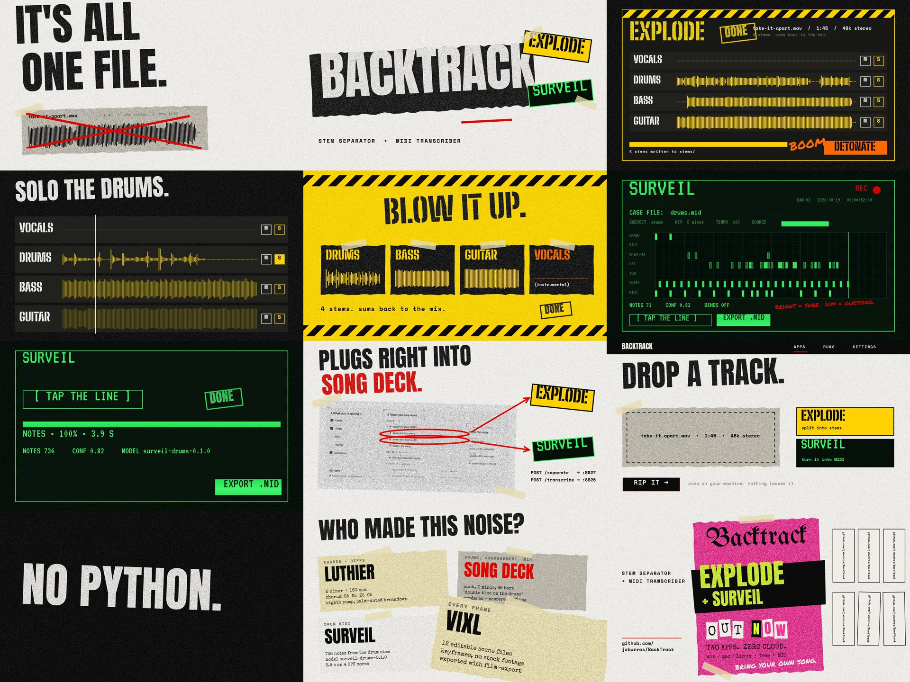

# BackTrack: take it apart

A 1:44 launch film for BackTrack and its two apps, Explode (stems) and Surveil (MIDI), made ahead of
the release so it is ready when both are done. It follows the [design language](../design/README.md)
shot for shot: bone paper and toner, torn scraps and tape, one shout and one hot colour per shot,
the Blast Zone and Wiretap themes for the apps, and the Gig Flyer for the closing card. The
soundtrack is a punk song written with [Luthier](https://github.com/JX-Holdings-LLC/Luthier) and
[Song Deck](https://github.com/jxburros/Song-Deck), and every frame is an editable
[Vixl](https://github.com/jxburros/Vixl) document.

**[`backtrack-take-it-apart.mp4`](backtrack-take-it-apart.mp4)** · 1:44 · 1920×1080 · 30 fps · AAC stereo 48 kHz



## The soundtrack

_Take It Apart_: garage punk in E minor at 160 BPM, 68 bars, no vocals. One bar is 1.5 s, and every
cut in the film falls on a section line. `scripts/promo/score.ts` builds it with no AI provider and
no samples:

1. **Luthier writes the parts.** The chord chart is Luthier's own data model: power chords, one a bar
   (`i VI III VII` for the intro, `III VII i VI` for the choruses), strummed with its _Eighth pump_
   pattern, palm-muted in the Breakdown and left ringing in the Intro. Luthier exports the guitar and
   the bass (root eighths, octave pops in the choruses) as MIDI, as its Export menu does. The chart is
   in [`luthier/chords.txt`](luthier/chords.txt), the parts in `luthier/guitar.mid` and `luthier/bass.mid`.
2. **Song Deck makes the song.** A punk blueprint on the same form and chords goes through
   `composeSong`; Luthier's two parts are imported with `midiToSong` in place of Song Deck's guitars
   (doubled left and right) and bass. Song Deck's drummer plays a backbeat, so two plain-language edits
   from its Change panel push it: "Double time on the drums" (a skate beat everywhere but the
   pre-choruses and Breakdown) and "Make the drums busier" (the pre-choruses).
3. **Song Deck renders and masters it.** `renderStems` writes drums, bass and guitars; the script sums
   them, following shot 04's solo moves (the drums alone for two bars, then the bass for one), and
   `masterAudio` masters the result for streaming.

What is on screen is what is playing. The waveforms in shots 03 to 05 are the soundtrack's own stems,
and the VOCALS stem is a flat line because the song is instrumental. Shot 04's S buttons follow the
solos you hear. The piano roll in shot 06 is BackTrack Surveil's real transcription of the drum stem
(`surveil/drums.json`: 736 notes, mean confidence 0.82, model `surveil-drums-0.1.0`, 3.9 s on four CPU
cores), drawn note by note as each one plays, bright where the model is sure (0.7 or more) and dim
where it is guessing. Shot 07's stage line counts that same 3.9 s.

Explode is not built yet (milestone S0), so its stems here come from Song Deck's renderer. The
screens show the apps as the design boards describe them, not the 0.1 pages.

## The cut

| Time | Shot                | Song section    | What it says                                                                 |
| ---- | ------------------- | --------------- | ---------------------------------------------------------------------------- |
| 0:00 | `01-one-file`       | Intro           | IT'S ALL ONE FILE. The mix as one waveform, crossed out: _we'll take it apart._ |
| 0:06 | `02-title`          | Build           | The band comes in. BACKTRACK, then the EXPLODE and SURVEIL stickers.         |
| 0:12 | `03-explode`        | Verse 1         | DETONATE. The hazard bar counts 22 chunks; four stems write themselves.      |
| 0:24 | `04-solo`           | Pre-Chorus 1    | Solo the drums, solo the bass, all back in. The mix follows the buttons.     |
| 0:30 | `05-blow-it-up`     | Chorus 1        | BLOW IT UP. The stems land as torn scraps. 4 stems, sums back to the mix.    |
| 0:42 | `06-surveil`        | Verse 2         | The case file: Surveil writes the drum stem down as it plays.                |
| 0:54 | `07-tap-the-line`   | Pre-Chorus 2    | [ TAP THE LINE ], the real run time, EXPORT .MID.                            |
| 1:00 | `08-song-deck`      | Chorus 2        | Song Deck's Services screen: _Separate into stems_ and _Make MIDI from audio_ are the two apps. |
| 1:12 | `09-hub`            | Breakdown       | The hub: DROP A TRACK, the two tiles, RIP IT →.                              |
| 1:18 | `10-no-cloud`       | Bridge          | No cloud. No Python. Win, Mac, Linux. CPU, CUDA, Vulkan, Metal. MIT. TAKE IT ALL APART. |
| 1:24 | `11-who-made-this`  | Final Chorus    | The credits: Luthier, Song Deck, Surveil, Vixl.                              |
| 1:30 | `12-out-now`        | Final Chorus, Outro | The gig flyer: OUT NOW. The tear-off tabs go on the last hits.          |

Shot 10 states plans as facts: Windows, macOS and Linux builds and the CUDA, Vulkan and Metal
backends are in [the plan](../docs/plans/overall.md), and the closing card says OUT NOW. Check both
against the release before publishing the film.

## What is in this folder

| Path                          | What it is                                                                   |
| ----------------------------- | ---------------------------------------------------------------------------- |
| `backtrack-take-it-apart.mp4` | The finished film                                                            |
| `contact-sheet.jpg`           | One frame from each shot                                                     |
| `scenes/*.vixl`               | Twelve editable 1920×1080 masters with keyframe timelines and embedded fonts |
| `film-spec.json`              | The `film-export` request: shot order, durations and the two-track audio mix |
| `song.json`                   | The soundtrack: form, chords, every note, the Song Deck edits and the solos  |
| `luthier/`                    | Luthier's chord chart and its guitar and bass MIDI                           |
| `surveil/`                    | Surveil's transcription of the drum stem (JSON and MIDI)                     |
| `art/song-deck-services.png`  | Song Deck's Services screenshot (from its `docs/images/`), used in shot 08   |
| `audio/`                      | The mastered song, its stems, the film's soundtrack and click track (written by the build, not committed) |

The recipe is in [`scripts/promo/`](../scripts/promo): `score.ts` (the soundtrack), `kit.py` (the
design language as Vixl operations), `scenes.py` (the shots), `make_video.py` (the whole build) and
`preview.py` (contact sheets for review).

## Rebuild

You need checkouts of Song Deck and Luthier next to this one (or `SONG_DECK=` and `LUTHIER=` pointing
at them) with their npm dependencies installed, Vixl 0.27 (`pip install vixl-engine` or an editable
checkout), Python 3.11+ with NumPy and Pillow, ffmpeg on `PATH`, and network access the first time,
when Vixl fetches the fonts. Build `backtrack-surveil` first to re-run the transcription; without it
the committed `surveil/drums.json` is used.

```bash
python scripts/promo/make_video.py              # soundtrack, Surveil, scenes and the MP4 (about 25 minutes on 4 cores)
python scripts/promo/make_video.py --scenes     # rebuild only the scene masters
python scripts/promo/preview.py /tmp/sheets 03 06   # contact sheets for selected shots
```

To change one shot, edit its master directly, for example
`vixl -p promo/scenes/12-out-now.vixl render --time 4s --out frame.png`, then re-run `film-export`
with `film-spec.json` (`vixl workflow film-export --request promo/film-spec.json --workspace promo`).
Re-running `make_video.py` overwrites the masters. Vixl, Song Deck and Luthier are authoring
dependencies only; building and running BackTrack does not need them.
